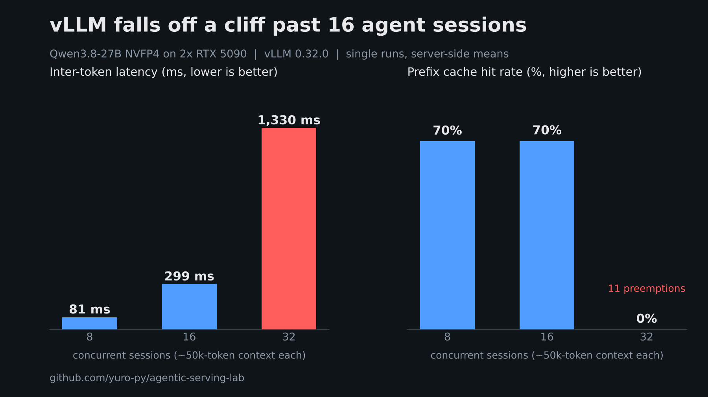

# agentic-serving-lab

Measuring how vLLM behaves under **agentic workloads**: multi-turn sessions, tool calls, long and growing shared prefixes, idle gaps while tools run.
Two phases, one method: the same experiment ladder, run first on a tiny model on a laptop GPU, then on a 27B model on two rented RTX 5090s.

## Headline findings (phase 2, Qwen3.8-27B on 2x RTX 5090)



- **Prefix caching is the biggest lever.** It works on the hybrid-attention model (92-98% eligible hit rate) and made multi-turn traces 2.5x faster (65 s vs 161 s).
- **There is a concurrency cliff.** With ~50k-token sessions, 16 concurrent sessions fit; at 32, cache hit rate falls from 70% to 0%, preemptions appear, and server ITL jumps from 0.3 s to 1.3 s.
- **MTP speculative decoding did not pay off** at any tested concurrency (flat at c1, -29% throughput at c8).
- **Memory knobs buy capacity, not speed**, until KV is the bottleneck: nvfp4 KV +73% tokens, `--language-model-only` +10%.
- **Hybrid models change the rules**: chunked prefill cannot be disabled, and the native FP4 backend failed to start on this stack (Marlin weight-only FP4 was used).

Details, tables, and caveats: [phase-2/README.md](phase-2/README.md).

*(Add 2-3 headline findings from phase 1 here, with numbers, so a reader sees how the small-model results compare.)*

## Repo map

| Path | What it is |
|---|---|
| [`phase-1/`](phase-1) | Qwen3-0.6B on an RTX 2050 (4 GB). Learn the harness and the experiment ladder cheaply. |
| [`phase-2/`](phase-2) | Qwen3.8-27B NVFP4 on 2x RTX 5090, ~$20 / ~10 GPU-hours. |
| `*/workloads/` | Agent traces as jsonl (turns, prompt/tool-output lengths, tool latency). |
| `*/runs/` | Raw logs for every experiment: vLLM log, trie log, GPU `dmon`, `/metrics` before and after. |
| `*/tools/` | `extract_run.py` (run dir to one-row summary), `check_workload.py`. |
| `*/trie/` | Vendored upstream harness (Apache-2.0). |

## Method

1. A workload is a jsonl of synthetic agent sessions. The harness replays them against a live vLLM server at a fixed concurrency.
2. Tool calls and results are generated by the harness, not the model, and assistant output lengths are forced. This makes runs repeatable and comparable, but it also means reply content is synthetic.
3. Every run is one server launch with one change from the baseline, then: snapshot `/metrics`, run the load, snapshot again, log GPU power and clocks.
4. Each experiment has a hypothesis, a control, and the exact command (`run_all_experiments.sh`, `experiments.xlsx`).

## What this does and does not show

- Shows how each vLLM knob moves latency, cache hit rate, KV usage, and preemptions under agent-shaped load.
- Does not show real-model behavior such as thinking length, tool-call quality, or true speculative-decoding acceptance.
- Most phase-2 results are single runs on 1-9 traces; treat differences under ~10% as noise.

## Reproduce

```bash
git clone https://github.com/yuro-py/agentic-serving-lab && cd agentic-serving-lab/phase-1   # or phase-2
pip install vllm==0.32.0
cd trie && uv pip install -e . && cd ..
source env.sh
./run_trie.sh        # see the phase README for experiment commands
```

## Next

- Live-agent mode (real model drives the loop) to measure thinking cost and task success
- Streaming client for per-request TTFT/ITL percentiles
- TP2 vs 2 replicas with session-sticky routing
- Native FP4 kernels on Blackwell once the backend works
- Repeats (n >= 3) on the experiments that matter

## Attribution

Built on Applied Compute's [`trie`](https://github.com/Applied-Compute/trie), licensed Apache-2.0. See `phase-*/trie/LICENSE`.
